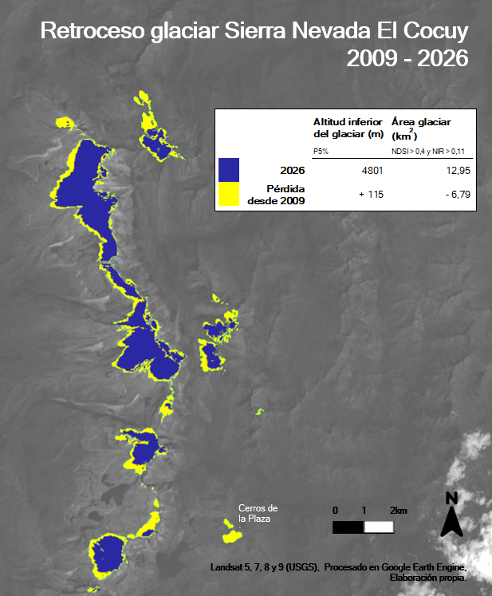

# Retroceso del glaciar de la Sierra Nevada del Cocuy (2009–2026)

Medición del área glaciar de la Sierra Nevada del Cocuy (Colombia) con imágenes Landsat en Google Earth Engine, trabajando en Python con apoyo de IA agentiva. Entre 2009 y 2026 la superficie de nieve y hielo pasó de **19,74 km² a 12,95 km²**, una pérdida aproximada del **34 %**, y el límite inferior del glaciar subió unos **115 m**.



## Resultados

### Área glaciar por temporada

| Temporada | Área (km²) |
|---|---:|
| 2009 | 19,74 |
| 2010 | 17,70 |
| 2024 | 12,32 |
| 2026 | 12,95 |

**Pérdida 2009–2026: ≈ 34 %.**

### Altitud de la nieve

| Temporada | Límite inferior, percentil 5 (m) | Mediana (m) |
|---|---:|---:|
| 2009 | 4.686 | 4.916 |
| 2026 | 4.801 | 4.956 |

El límite inferior sube 115 m en 17 años. 

## Validación con el IDEAM

Las temporadas 2010 y 2024 se eligieron para comparar con el área glaciar oficial del IDEAM.

| Temporada | Este método (km²) | IDEAM (km²) | Diferencia |
|---|---:|---:|---:|
| 2010 | 17,70 | 16,54 | +7 % |
| 2024 | 12,32 | 11,88 | +4 % |

| Pérdida 2010–2024 | |
|---|---:|
| Este método | 30 % |
| IDEAM | 28 % |

El método sobreestima ligeramente el área absoluta, pero reproduce bien la tendencia de pérdida.

## Método

1. **Datos.** Landsat 5, 7, 8 y 9 Collection 2 Level 2 (reflectancia de superficie) y el modelo de elevación Copernicus DEM GLO-30, consultados en Google Earth Engine.
2. **Área de estudio.** Rectángulo basado en los límites del glaciar del IDEAM (6°21'–6°33' N, 72°15'–72°19' O) con un margen de unos 2 km. Se comprobó con el DEM que incluyera todo el terreno por encima de 4.200 m.
3. **Selección de fechas.** Para cada temporada seca (diciembre del año anterior a febrero) se revisaron las imágenes disponibles y se eligieron a mano las fechas con el glaciar despejado. No se usó la máscara automática de nubes CFMask porque marcaba como nube el borde del glaciar, lo que habría reducido el área medida.
4. **Composite.** Se unifican las bandas de los cuatro satélites (azul, verde, rojo, NIR, SWIR1 y SWIR2) y se calcula la mediana de las fechas seleccionadas de cada temporada.
5. **Clasificación.** Un píxel es nieve o hielo si cumple todos estos criterios:
   - **NDSI > 0,4:** índice clásico para detectar nieve y hielo.
   - **NIR > 0,11:** descarta el agua, que también tiene NDSI alto pero refleja muy poco en el infrarrojo cercano.
   - **Altitud > 4.200 m:** límite superior del páramo alto según el IGAC.
   - **Fuera de la zona excluida:** polígono dibujado a mano tras revisión visual, que elimina un área clasificada como nieve por un problema de los datos de Landsat 7.
6. **Exportación y estadísticas.** Los composites, el NDSI, la nieve y el DEM se exportan como GeoTIFF en EPSG:32618 (UTM 18N) a 30 m. Con rasterio se calcula el área de nieve y la altitud de sus píxeles.

## Limitaciones y mejoras pendientes

- **Resolución de 30 m.** Los píxeles del borde del glaciar mezclan nieve y roca, lo que limita la precisión del área.
- **Nieve estacional.** En las paredes empinadas orientadas al este del flanco occidental queda nieve estacional que se clasifica como glaciar y sobreestima el área. Esto explica que 2026 salga algo mayor que 2024.
- **Zona excluida manual.** Depende de una revisión visual y no se generaliza a otras zonas o fechas.
- **Mejora pendiente:** añadir un filtro de pendiente para descartar la nieve estacional de las paredes empinadas.

## Estructura del repositorio

```
├── data/input/
│   └── zona_excluida.geojson   # polígono excluido de la clasificación
├── notebooks/
│   ├── a_config.py             # parámetros: proyecto GEE, área, temporadas, fechas y umbrales
│   ├── 01_connection_gee.py
│   ├── 02_study_area.py
│   ├── 03_landsat_availability.py
│   ├── 04_composite.py
│   ├── 05_estadisticas.py
│   └── tests/
│       ├── 03_01_prueba_image_L5_L7.py
│       └── 03_01_prueba_image_todosL.py
├── outputs/
│   └── mapa.png                # mapa final. Hecho con QGIS
└── environment.yml
```

| Script | Qué hace |
|---|---|
| `01_connection_gee.py` | Conecta VS Code con la cuenta de Google Earth Engine. |
| `02_study_area.py` | Define el área de estudio a partir de la del IDEAM y verifica con el DEM de Copernicus que incluya el terreno por encima de 4.200 m. |
| `03_landsat_availability.py` | Evaluación preliminar de las imágenes Landsat 5, 7, 8 y 9 disponibles en cada temporada, según su cobertura de nubes. |
| `tests/03_01_*.py` | Revisión manual de las imágenes más limpias a partir de los resultados del script 03. De aquí salen las fechas analizadas. |
| `04_composite.py` | Composite por mediana, NDSI y clasificación de nieve de cada temporada. Muestra un mapa del año elegido para comprobar el resultado y exporta los rásters y el DEM. |
| `05_estadisticas.py` | Calcula el área de nieve en km² y la altitud del límite inferior (percentil 5). |

## Cómo reproducirlo

1. Crear y activar el entorno:

   ```
   conda env create -f environment.yml
   conda activate glaciar-cocuy
   ```

2. Tener una cuenta de Google Earth Engine con un proyecto de Google Cloud y poner su identificador en `PROYECTO_GEE`, en `notebooks/a_config.py`.
3. Ejecutar los scripts en orden desde la carpeta `notebooks/`, celda por celda en VS Code (`# %%`). El script `01` solo es necesario la primera vez, para autenticarse.

Los GeoTIFF no están en el repositorio por su tamaño. `04_composite.py` los genera en `outputs/`, y `05_estadisticas.py` los lee desde allí.

## Fuentes

- **Landsat Collection 2 Level 2:** USGS, consultado en Google Earth Engine.
- **Copernicus DEM GLO-30:** Agencia Espacial Europea (ESA).
- **Área glaciar oficial y límites del glaciar:** IDEAM.
- **Límite superior del páramo alto (4.200 m):** IGAC.
